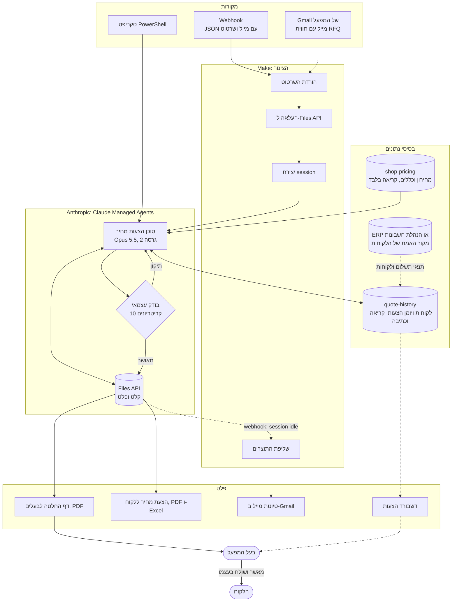
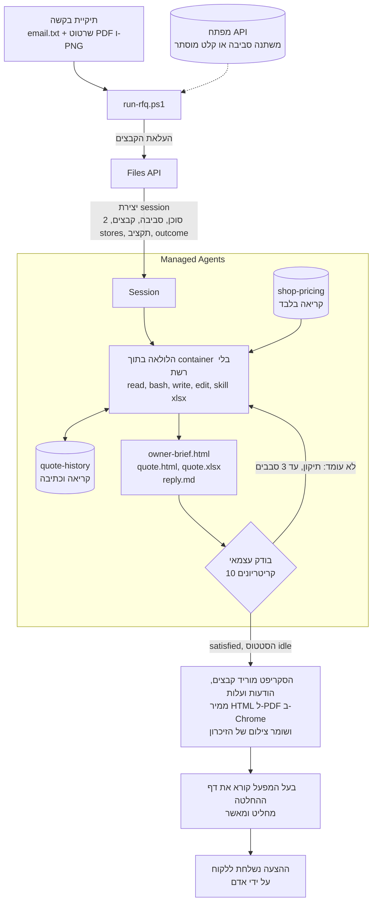
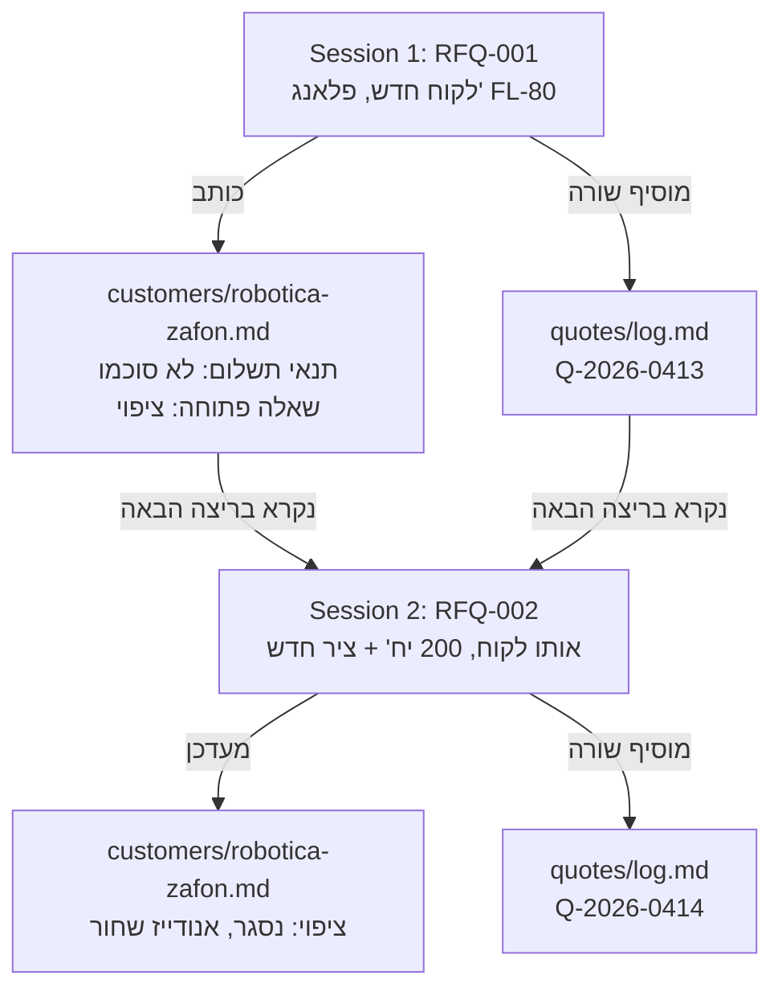
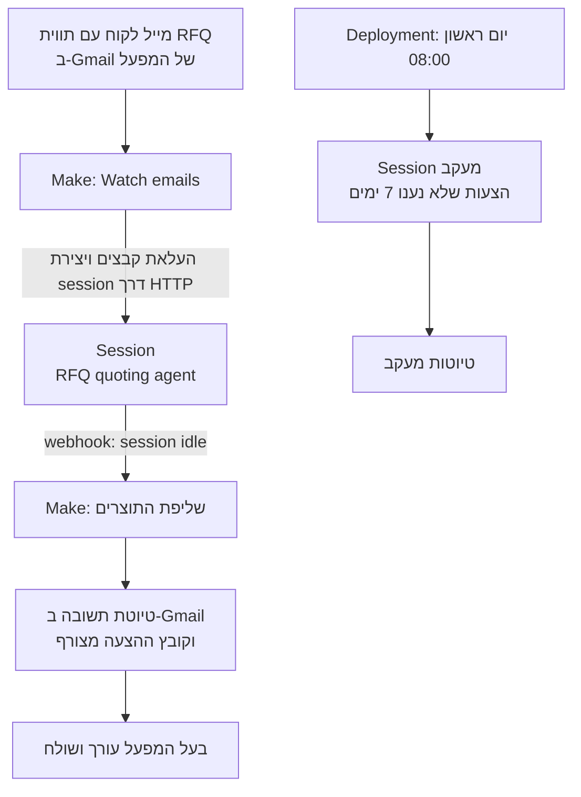

# Architecture: סוכן הצעות מחיר על Claude Managed Agents

איך המידע זורם מהרגע שמגיעה בקשה להצעת מחיר, ועד שבעל המפעל מאשר את ההצעה. בהתחלה יש תמונה של המערכת כולה. אחריה: מה שנבנה ורץ, איך הזיכרון עובר בין ריצות, איך עובדות הגרסאות, ומה מתוכנן לפיילוט.

## 0. המערכת כולה

קו מלא הוא חלק שנבנה ורץ. קו מקווקו הוא חלק מתוכנן.

| שכבה | מה יש בה | מצב |
|---|---|---|
| מקורות | webhook ב-Make, סקריפט PowerShell. בפיילוט: Gmail | webhook וסקריפט רצו. Gmail מתוכנן |
| צינור | Make: מוריד, מעלה, יוצר session ([make/README.md](make/README.md)) | רץ. שליפת התוצרים חזרה ל-Make מתוכננת |
| סוכן | Claude Managed Agents: סוכן, container בלי רשת, בודק עצמאי | רץ, 5 ריצות |
| בסיסי נתונים | שני memory stores: מחירון והיסטוריה | רצים. סנכרון מול ERP מתוכנן |
| פלט | דף החלטה, הצעת מחיר, Excel, טיוטת מייל | רץ. טיוטה ב-Gmail מתוכננת |
| דשבורד | הצעות פתוחות, החלטות שמחכות לבעלים, הצעות בלי תשובה 7 ימים, עלות לכל ריצה ואחוז הצעות שהתקבלו | מתוכנן |

**הדשבורד המתוכנן.** בעל מפעל לא פותח תיקיות. הוא צריך מסך אחד שעונה על שלוש שאלות: מה מחכה לי, מה תקוע אצל הלקוח, וכמה זה עולה לי. הנתונים כבר קיימים: `quotes/log.md` ב-`quote-history` מחזיק שורה לכל הצעה עם סטטוס, וה-session שומר עלות וזמן. הדשבורד קורא אותם דרך ה-API, ולא כותב לשום מקום. מי שמשנה סטטוס הוא בעל המפעל או הסוכן, אף פעם לא הדשבורד.

**למה בסיס הנתונים מפוצל.** המחירון לקריאה בלבד, כי את המחירים קובע בעל המפעל. ההיסטוריה לקריאה וכתיבה, כי הסוכן מוסיף לה אחרי כל הצעה. ה-ERP נשאר מקור האמת של הלקוחות ולא עולה לענן כמו שהוא. ל-`quote-history` מועתק רק מה שהסוכן צריך, בהתאם לגבולות שבסעיף 6.

## 1. הזרימה, כפי שרצה ב-24.11.2026 (גרסה 2)

## 2. הרכיבים

| רכיב | מה הוא | איפה הוא גר |
|---|---|---|
| תיקיית בקשה | מייל הלקוח ושרטוטים | המחשב של המפעל. בפיילוט: Gmail |
| `setup-rfq-agent.ps1` | יוצר פעם אחת סביבה, סוכן ושני stores, וטוען לתוכם את קובצי ה-seed | המחשב שלי |
| `run-rfq.ps1` | בקשה אחת: העלאה, session, המתנה, הורדה, PDF וצילום של הזיכרון. עם `-ResumeSessionId` אוסף session קיים בלי ליצור חדש | המחשב שלי |
| `upgrade-agent.ps1` | מעדכן את הסוכן לגרסה חדשה, ופותח store נקי להיסטוריה | המחשב שלי |
| Agent `RFQ quoting agent` | המוח, הידיים והמטרה. נשמר עם מספר גרסה | Anthropic |
| Environment `rfq-offline` | container בענן, networking: limited בלי שרתים מורשים | Anthropic |
| Memory store `shop-pricing` | מחירון וכללים. read_only | Anthropic |
| Memory store `quote-history` | לקוחות ויומן הצעות. read_write, עם גרסה לכל שינוי | Anthropic |
| Outcome grader | בודק את התוצרים מול ה-rubric ומחזיר לתיקון | Anthropic |
| Chrome מקומי | ממיר את ה-HTML ל-PDF. העברית מימין לשמאל מוצגת נכון | המחשב שלי |
| תיקיית ריצה | `runs/<בקשה>-<זמן>/`: תוצרים, הודעות הסוכן, עלות, הזיכרון אחרי הריצה | המחשב שלי |

## 3. הזרימה, צעד אחר צעד

1. הסקריפט מעלה כל קובץ בתיקיית הבקשה ל-Files API, ומקבל `file_id` לכל אחד.
2. הסקריפט יוצר session עם הסוכן בגרסה נעוצה, הסביבה, הקבצים (נטענים ל-`/mnt/session/uploads/rfq/`), שני ה-stores, תקציב של 5 דולר, ו-`user.define_outcome` עם ה-rubric.
3. ה-stores נטענים כתיקיות: `/mnt/memory/shop-pricing/` לקריאה בלבד, ו-`/mnt/memory/quote-history/` לקריאה וכתיבה.
4. הסוכן קורא קודם את הכללים והמחירון, אחר כך את המייל ואת השרטוטים, ובודק בהיסטוריה אם הלקוח והחלק מוכרים.
5. הסוכן מחשב ב-Python: חומר גלם, משקל, setup, זמני מחזור, קבלני משנה ו-margin. לכל נקודה פתוחה הוא מחשב את המחיר וזמן האספקה של כל אפשרות. ואז כותב דף החלטה לבעלים והצעת מחיר ללקוח (HTML), Excel עם החישוב, וטיוטת מייל, ובודק אותם בעצמו מול ה-Excel.
6. הסוכן מעדכן את `quote-history`: קובץ לקוח ושורה ביומן. כל כתיבה נשמרת כגרסה.
7. הבודק העצמאי בודק את 10 הקריטריונים, ומחזיר לתיקון אם צריך. הוא גם מדפיס את דף הבעלים ל-A4 כדי לבדוק שהוא לא עובר שני עמודים.
8. כשה-session עובר ל-idle, הסקריפט מוריד את התוצרים, ממיר את קובצי ה-HTML ל-PDF עם Chrome המקומי, ושומר צילום של `quote-history` אחרי הריצה.
9. בעל המפעל קורא את דף ההחלטה, מחליט, ושולח בעצמו את הצעת המחיר והמייל.

## 4. הזיכרון בין שתי ריצות

זה מה שהופך את הסוכן מכלי חד-פעמי למשהו שמכיר את הלקוחות של המפעל.

בריצה השנייה הלקוח כותב "אותם תנאי תשלום שסיכמנו". הזיכרון מראה שלא סוכם כלום, ולכן הסוכן צריך לשאול את הבעלים ולא לקבל את הבקשה.

## 5. גרסאות

הסוכן שמור כאובייקט עם מספר גרסה. גרסה 2 נוצרה כעדכון של אותו agent ID (`POST /v1/agents/{id}`), וכל session נעוץ לגרסה שלו. ריצה שהתחילה על גרסה 1 נשארת עליה, גם אם הסוכן מתעדכן באמצע.

| | גרסה 1 | גרסה 2 |
|---|---|---|
| לבעלים | הערה בטקסט | דף החלטה ב-PDF: מחיר והחלטות בעמוד הראשון |
| ללקוח | טיוטת מייל | הצעת מחיר ב-PDF, וגם טיוטת מייל |
| rubric | 8 קריטריונים | 10 קריטריונים |

## 6. גבולות: מה נכנס לענן ומה לא

| נכנס | לא נכנס |
|---|---|
| המייל והשרטוטים של הבקשה | מפתח ה-API, חוץ מכותרת הבקשה ל-API |
| המחירון והכללים | כתובות מייל וטלפונים של לקוחות, לא נשמרים בזיכרון |
| יומן ההצעות וקובצי הלקוחות | ERP, הנהלת חשבונות, Gmail |
| התוצרים שהסוכן כתב | גישה לאינטרנט מתוך ה-container |

אצל מפעל אמיתי: מחירון ושרטוטים של לקוחות עולים לענן רק אחרי אישור בכתב. שרטוט מסווג או ביטחוני לא עולה בכלל, ובמקרה כזה בוחרים environment מסוג self-hosted, או לא משתמשים בסוכן.

## 7. פיילוט (נבנה בחלקו)

החצי הראשון כבר בנוי ונבדק: scenario ב-Make מקבל webhook, מוריד את השרטוט, מעלה אותו ואת המייל ל-Files API, ויוצר session של הסוכן דרך HTTP. ב-24.11.2026 הוא הריץ את RFQ-001, והבודק העצמאי אישר בבדיקה הראשונה. הפירוט: [make/README.md](make/README.md#השילוב-make-מפעיל-את-סוכן-claude). מה שעוד לא בנוי: טריגר מ-Gmail במקום webhook, והחזרת התוצרים ל-Make כשה-session מסתיים.

מה משתנה בפיילוט:

- טריגר: Make מזהה מייל עם תווית, במקום להריץ סקריפט ביד.
- מעקב: webhook כשה-session עובר ל-idle, במקום לבדוק סטטוס כל 15 שניות.
- מסירה: טיוטה ב-Gmail. מי שלוחץ "שלח" הוא תמיד אדם.
- הרצה מתוזמנת: deployment שבועי שמכין טיוטות מעקב להצעות פתוחות. התבנית ב-`templates/deployment-followup.planned.json`.

[להחליט מול הלקוח] מי מקבל את ההתראה, ואיך שרטוטים גדולים (DWG, STEP) מומרים ל-PDF לפני ההעלאה.
