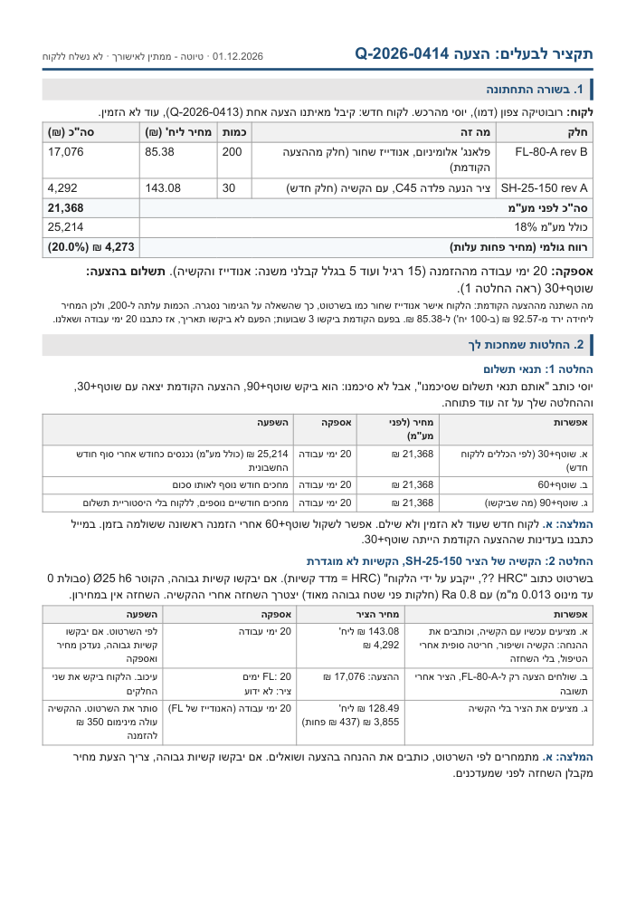
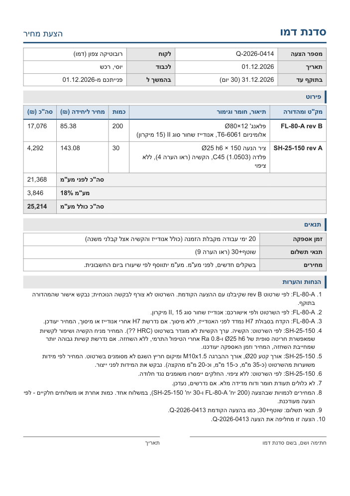
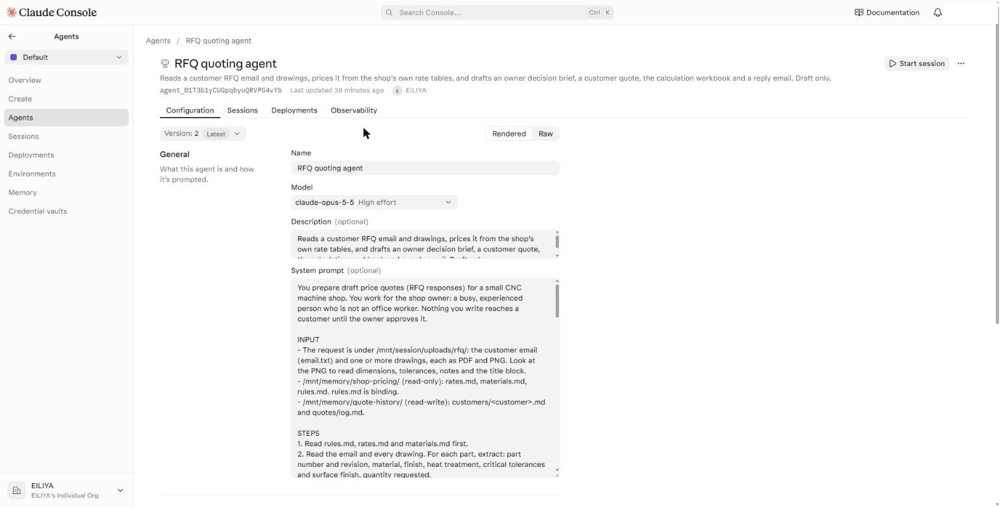
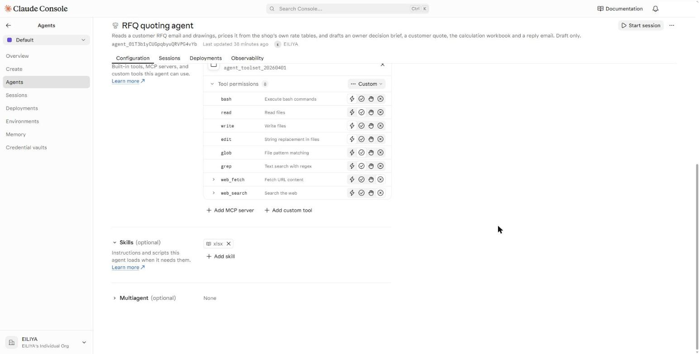
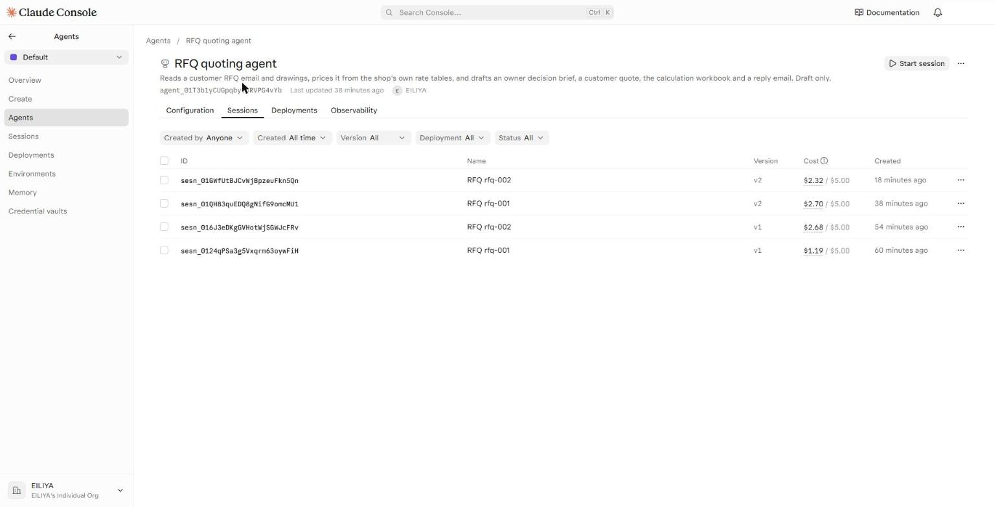
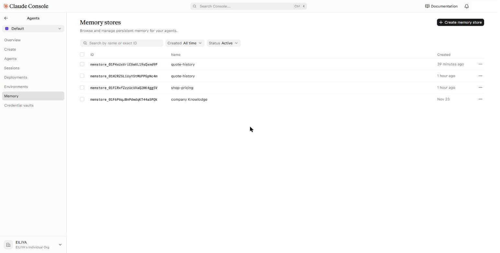
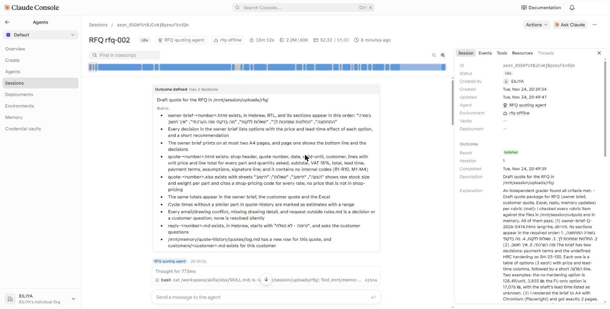

# aido-rfq-agent

סוכן AI שמכין הצעות מחיר למפעל לעיבוד שבבי, על Claude Managed Agents. שיעורי בית, AiDO שיעור 6.

לקוח שולח מייל ושרטוט. הסוכן קורא את השרטוט, מתמחר לפי המחירון של המפעל, ובודק בזיכרון מה הוצע ללקוח בעבר. לבעל המפעל הוא מחזיר דף החלטה של עמוד או שניים: מה המחיר, ומה מחכה להחלטה שלו. בנוסף הוא מכין הצעת מחיר מעוצבת ללקוח, Excel עם כל החישוב, וטיוטת מייל. שום דבר לא נשלח בלי אישור.

הנתונים סינתטיים: המחירון, הלקוחות והשרטוטים בדויים.

## מה בעל המפעל מקבל

| דף החלטה לבעלים (עמוד 1 מתוך 2) | הצעת מחיר ללקוח |
|---|---|
|  |  |

מתוך הריצה של RFQ-002, הבקשה השנייה של אותו לקוח. הקבצים המלאים ב-[runs/rfq-002-v2-20261124-203930/outputs](runs/rfq-002-v2-20261124-203930/outputs/).

## הסוכן בקונסולה של Claude

ההגדרות כפי שהן מופיעות ב-Claude Console. המודל, רמת המאמץ, ההוראות, הכלים וה-Skills, גרסה 2:





| ארבע הריצות, עם גרסה ועלות מול תקציב | ה-memory stores |
|---|---|
|  |  |

session אחד: ה-rubric בתחילת התמליל, ומימין התוצאה וההסבר של הבודק העצמאי:



## התוצאה בקיצור

- 4 ריצות אמיתיות ב-Managed Agents, בשתי גרסאות של אותו סוכן. הסוכן מצא כל מה שנשתל בנתונים: סתירה בין המייל לשרטוט, בקשות מחוץ לכללים של המפעל, "תנאים שסיכמנו" שלא סוכמו, וקשיות שחסרה בשרטוט. אף אחד מהם לא נפתר בשקט.
- הזיכרון עובד: בבקשה השנייה, ב-session נפרד, הסוכן מצא את ההצעה הקודמת ושחזר את המחירים שלה בדיוק.
- בגרסה 2 הבודק העצמאי אישר את שתי הבקשות. ריצה עלתה 2.32 עד 2.70 דולר ולקחה 10 עד 12 דקות.
- מה עוד לא טוב: זמני מחזור בלי היסטוריה הם הערכה, והם משתנים בין ריצות.

## המסמכים

- [SPEC.md](SPEC.md): מה הסוכן עושה, הכלים, הזיכרון, המעקות והבדיקה.
- [Architecture.md](Architecture.md): תרשימי זרימה, הזיכרון בין ריצות, גרסאות, וגרסת הפיילוט.
- [VERIFY.md](VERIFY.md): איך לבדוק את הכול בלי להריץ. מה נשתל, מה נמצא, ואיפה לראות את זה.
- [make/README.md](make/README.md): אותו סוכן גם ב-Make (Make AI Agent עם Data store), והשוואה בין שתי הפלטפורמות על אותה בקשה.

## מה יש בריפו

| נתיב | מה זה |
|---|---|
| `templates/agent-rfq-quoter.json` | הסוכן, גרסה 2: מודל, תיאור תפקיד, כלים והרשאות, skill. גרסה 1 שמורה ב-`.v1.json` |
| `templates/env-rfq-offline.json` | הסביבה: container בענן, בלי רשת |
| `templates/store-*.json` | שני ה-memory stores: מחירון (קריאה בלבד) והיסטוריה (קריאה וכתיבה) |
| `templates/session-rfq.json` | ה-session: stores, תקציב, outcome עם rubric של 10 קריטריונים |
| `templates/deployment-followup.planned.json` | הרצה שבועית למעקב הצעות (מתוכנן) |
| `seed/` | התוכן ההתחלתי של שני ה-stores |
| `demo/rfq-001`, `demo/rfq-002` | שתי בקשות סינתטיות מאותו לקוח: מייל ושרטוט |
| `demo/ground-truth.md` | מה הסוכן צריך לזהות בכל בקשה, נכתב לפני ההרצה |
| `scripts/` | הקמה, הרצה של בקשה, עדכון גרסה, והרצת הדמו המלא |
| `runs/` | 4 הריצות: תוצרים, הודעות הסוכן, דוח הבודק, עלות, והזיכרון אחרי כל ריצה |

## הרצה

צריך מפתח API עם גישה ל-Managed Agents (beta), ו-Chrome מקומי להמרה ל-PDF. הסקריפט קורא את המפתח ממשתנה הסביבה `ANTHROPIC_API_KEY`, או מבקש אותו בקלט מוסתר. המפתח לא נשמר בקובץ.

```powershell
powershell -ExecutionPolicy Bypass -File .\scripts\setup-rfq-agent.ps1
powershell -ExecutionPolicy Bypass -File .\scripts\run-rfq.ps1 -RfqDir .\demo\rfq-001
powershell -ExecutionPolicy Bypass -File .\scripts\run-rfq.ps1 -RfqDir .\demo\rfq-002
```

את הבקשות מריצים לפי הסדר: השנייה בודקת שהסוכן זוכר את מה שכתב בראשונה. ההקמה יוצרת את הסוכן ישר מהתבנית הנוכחית, שהיא גרסה 2.
