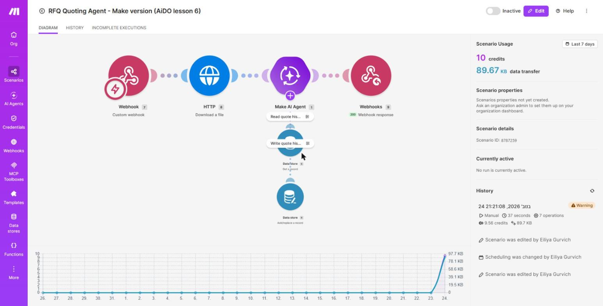

# אותו סוכן ב-Make

אותו סוכן הצעות מחיר, באותו מחירון, עם אותם כללים ואותה בקשה (RFQ-001), נבנה גם ב-Make, כדי להשוות בין שתי הפלטפורמות מהשיעור.

## מה נבנה

| רכיב | ב-Make |
|---|---|
| טריגר | Custom webhook. מקבל JSON עם `rfq_id`, `email` ו-`drawing_url` (דוגמאות: [rfq-001.json](rfq-001.json), [rfq-002.json](rfq-002.json)) |
| קלט השרטוט | מודול HTTP "Download a file" מוריד את ה-PNG מהריפו ומעביר אותו לסוכן כ-Input file |
| הסוכן | מודול Make AI Agent. ההוראות: אותו תיאור תפקיד, ובתוכו המחירון והכללים, כלומר קריאה בלבד |
| מודל | Make's AI Provider, "Medium" (gpt-5-nano). בתוכנית החינמית אלה האפשרויות היחידות: Small או Medium |
| זיכרון | Data store בשם `rfq_quote_history`, עם שני כלים לסוכן: Read quote history (Get a record) ו-Write quote history (Add/replace a record) |
| פלט | Webhook response עם התשובה של הסוכן |

## מה יצא ב-RFQ-001

הריצה לקחה 37 שניות ועלתה 9.56 קרדיטים (מתוך 1,000 בחודש בתוכנית החינמית). התשובה המלאה, בלי עריכה: [response-rfq-001.md](response-rfq-001.md).

| נבדק | הנכון ([ground-truth](../demo/ground-truth.md)) | גרסת Anthropic (Opus 5.5) | גרסת Make (gpt-5-nano) |
|---|---|---|---|
| סתירה: המייל "בלי ציפוי", השרטוט אנודייז | לתמחר לפי השרטוט ולשאול | נמצאה, הפכה להחלטה ולשאלה | לא נמצאה. כתב "לא נדרש לפי השרטוט" |
| משקל חומר גלם | 0.260 ק"ג | 0.260 ק"ג | 0.122 ק"ג |
| מחיר 100 יח' מול 50 יח' | ליחידה זול יותר | 92.57 מול 111.32 ₪ | 133.9 מול 119 ₪: יקר יותר ליחידה |
| שוטף+90 מלקוח חדש | החלטה לבעלים | החלטה לבעלים | שאלה ללקוח "מאשר את שוטף+90?" |
| זמן אספקה עם אנודייז | 20 ימי עבודה | 20 ימי עבודה | 15 ימי עבודה |
| כתיבה לזיכרון | שורה ב-quotes/log וקובץ לקוח | שניהם | רשומה חדשה במפתח אקראי, עם שם לקוח שגוי, ובלי קובץ לקוח ([צילום](make-2-data-store-after-run.png)) |
| עקביות הסכומים | אותו סכום בכל מקום | זהה בשלושת המסמכים | 5,956 ו-4,767 ₪ לאותה שורה |

## מה למדתי מההשוואה

- **ה-scenario הוא לא הבעיה.** הטריגר, הורדת השרטוט, הכלים והזיכרון עבדו ב-Make. הסוכן קרא מההיסטוריה פעמיים וכתב אליה פעם אחת.
- **המודל הוא הבעיה.** אותן הוראות על מודל קטן נתנו שגיאות חישוב ושגיאות שיקול דעת, ופספסו בדיוק את מה שסוכן הצעות מחיר חייב לתפוס.
- **אין בודק.** ב-Managed Agents יש outcome עם בודק עצמאי, שמחזיר לתיקון. ב-Make אין שלב כזה, ולכן שגיאה יוצאת כמו שהיא.
- **מתי Make כן מתאים:** טריגרים, הזזת קבצים, Data store וחיבור ל-Gmail ול-Sheets. החלק שדורש שיקול דעת צריך מודל חזק, וכאן בדיוק השילוב שהשיעור הציג: Make מזיז את המידע, ו-Claude חושב.

## מה אפשר לשפר בגרסת Make

1. לחבר את מודול ה-AI Agent למודל חזק יותר, עם חיבור Anthropic ומפתח API, או בתוכנית Make בתשלום.
2. להוציא את החשבון מהמודל: מודול של Make מחשב משקל ומחיר, והסוכן רק קורא את השרטוט ומחליט.
3. להוסיף שלב בדיקה: מודול שני שבודק את התשובה מול הכללים לפני שהיא יוצאת.
