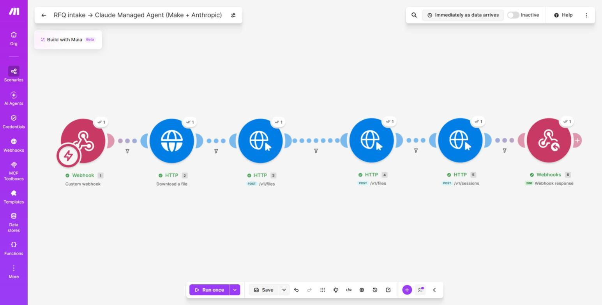

# אותו סוכן ב-Make

אותו סוכן הצעות מחיר, באותו מחירון, עם אותם כללים ואותה בקשה (RFQ-001), נבנה גם ב-Make, כדי להשוות בין שתי הפלטפורמות מהשיעור. יש כאן שני scenarios:

1. **הסוכן כולו ב-Make:** מודול Make AI Agent עם Data store כזיכרון. עבד, אבל המודל החינמי טעה. ההשוואה בהמשך.
2. **השילוב:** Make מקבל את הבקשה, מזיז את הקבצים ומפעיל את סוכן Claude Managed Agents. [הסעיף האחרון](#השילוב-make-מפעיל-את-סוכן-claude).

## מה נבנה (scenario 1)


| רכיב | ב-Make |
|---|---|
| טריגר | Custom webhook. מקבל JSON עם `rfq_id`, `email` ו-`drawing_url` (דוגמאות: [rfq-001.json](rfq-001.json), [rfq-002.json](rfq-002.json)) |
| קלט השרטוט | מודול HTTP "Download a file" מוריד את ה-PNG מהריפו ומעביר אותו לסוכן כ-Input file |
| הסוכן | מודול Make AI Agent. ההוראות: אותו תיאור תפקיד, ובתוכו המחירון והכללים, כלומר קריאה בלבד |
| מודל | Make's AI Provider, "Medium" (gpt-5-nano). בתוכנית החינמית אלה האפשרויות היחידות: Small או Medium |
| זיכרון | Data store בשם `rfq_quote_history`, עם שני כלים לסוכן: Read quote history (Get a record) ו-Write quote history (Add/replace a record) |
| פלט | Webhook response עם התשובה של הסוכן |

## מה יצא ב-RFQ-001

הריצה לקחה 37 שניות ועלתה 9.56 קרדיטים (מתוך 1,000 בחודש בתוכנית החינמית). התשובה המלאה, בלי עריכה: [response-rfq-001.md](response-rfq-001.md).

| נבדק | הנכון ([ground-truth](../demo/ground-truth.md)) | גרסת Anthropic (Opus 5.5) | גרסת Make (gpt-5-nano) |
|---|---|---|---|
| סתירה: המייל "בלי ציפוי", השרטוט אנודייז | לתמחר לפי השרטוט ולשאול | נמצאה, הפכה להחלטה ולשאלה | לא נמצאה. כתב "לא נדרש לפי השרטוט" |
| משקל חומר גלם | 0.260 ק"ג | 0.260 ק"ג | 0.122 ק"ג |
| מחיר 100 יח' מול 50 יח' | ליחידה זול יותר | 92.57 מול 111.32 ₪ | 133.9 מול 119 ₪: יקר יותר ליחידה |
| שוטף+90 מלקוח חדש | החלטה לבעלים | החלטה לבעלים | שאלה ללקוח "מאשר את שוטף+90?" |
| זמן אספקה עם אנודייז | 20 ימי עבודה | 20 ימי עבודה | 15 ימי עבודה |
| כתיבה לזיכרון | שורה ב-quotes/log וקובץ לקוח | שניהם | רשומה חדשה במפתח אקראי, עם שם לקוח שגוי, ובלי קובץ לקוח ([צילום](make-2-data-store-after-run.png)) |
| עקביות הסכומים | אותו סכום בכל מקום | זהה בשלושת המסמכים | 5,956 ו-4,767 ₪ לאותה שורה |

## מה למדתי מההשוואה

- **ה-scenario הוא לא הבעיה.** הטריגר, הורדת השרטוט, הכלים והזיכרון עבדו ב-Make. הסוכן קרא מההיסטוריה פעמיים וכתב אליה פעם אחת.
- **המודל הוא הבעיה.** אותן הוראות על מודל קטן נתנו שגיאות חישוב ושגיאות שיקול דעת, ופספסו בדיוק את מה שסוכן הצעות מחיר חייב לתפוס.
- **אין בודק.** ב-Managed Agents יש outcome עם בודק עצמאי, שמחזיר לתיקון. ב-Make אין שלב כזה, ולכן שגיאה יוצאת כמו שהיא.
- **מתי Make כן מתאים:** טריגרים, הזזת קבצים, Data store וחיבור ל-Gmail ול-Sheets. החלק שדורש שיקול דעת צריך מודל חזק, וכאן בדיוק השילוב שהשיעור הציג: Make מזיז את המידע, ו-Claude חושב.

## מה אפשר לשפר בגרסת Make

1. לחבר את מודול ה-AI Agent למודל חזק יותר, עם חיבור Anthropic ומפתח API, או בתוכנית Make בתשלום.
2. להוציא את החשבון מהמודל: מודול של Make מחשב משקל ומחיר, והסוכן רק קורא את השרטוט ומחליט.
3. להוסיף שלב בדיקה: מודול שני שבודק את התשובה מול הכללים לפני שהיא יוצאת.

את האפשרות הראשונה בניתי בצורה אחרת: Make לא מריץ מודל בכלל, אלא מפעיל את הסוכן של Claude. הפירוט בסעיף הבא.

## השילוב: Make מפעיל את סוכן Claude



ב-scenario השני Make עושה את מה שהוא טוב בו, להזיז קבצים ונתונים, ואת החשיבה עושה אותו סוכן Claude Managed Agents מהריצות הקודמות, גרסה 2. אין בו מודול AI של Make.

| מודול | מה הוא עושה |
|---|---|
| 1. Custom webhook | מקבל את אותו JSON: `rfq_id`, `email`, `drawing_url` |
| 2. HTTP, Download a file | מוריד את השרטוט |
| 3. HTTP, POST `/v1/files` | מעלה את השרטוט ל-Files API של Anthropic |
| 4. HTTP, POST `/v1/files` | מעלה את המייל כ-`email.txt` |
| 5. HTTP, POST `/v1/sessions` | יוצר session: הסוכן (גרסה 2), הסביבה, שני ה-memory stores, שני הקבצים ב-`/rfq/`, תקציב של 5 דולר, ו-outcome עם 10 הקריטריונים. אותו body כמו [session-rfq.json](../templates/session-rfq.json) |
| 6. Webhook response | מחזיר את מזהה ה-session |

החיבור ל-Anthropic הוא חיבור HTTP מסוג API key ב-Make (header `x-api-key`). המפתח שמור ב-Make ולא מופיע ב-scenario. מודול 5 שולח גם `anthropic-version: 2026-10-21` ו-`anthropic-beta: managed-agents-2026-04-01`.

ל-session הזה יש memory store נפרד של היסטוריה, `quote-history` חדש עם אותו תוכן התחלתי ([seed/history](../seed/history/)), כדי שהריצה תתחיל מאותו מצב כמו RFQ-001 בריצות הקודמות.

את התוצרים אספתי בסוף עם אותו סקריפט, בלי ליצור session חדש:

```powershell
powershell -ExecutionPolicy Bypass -File .\scripts\run-rfq.ps1 -RfqDir .\demo\rfq-001 -ResumeSessionId <session_id> -HistoryStoreId <memstore_id> -RunLabel make
```

### מה יצא ב-RFQ-001

הריצה: [runs/rfq-001-make-v2-20261124-215043](../runs/rfq-001-make-v2-20261124-215043/). Make סיים את ששת המודולים בכמה שניות, והחזיר את מזהה ה-session. הסוכן רץ 9.4 דקות פעילות ועלה 2.10 דולר. הבודק העצמאי אישר את כל 10 הקריטריונים בבדיקה הראשונה ([grader-report.md](../runs/rfq-001-make-v2-20261124-215043/grader-report.md)).

| נבדק | הנכון | gpt-5-nano בתוך Make | Claude, מופעל מ-Make |
|---|---|---|---|
| סתירה: "בלי ציפוי" מול אנודייז | לתמחר לפי השרטוט ולשאול | לא נמצאה | החלטה לבעלים ושאלה ללקוח, עם מחיר בלי ציפוי |
| משקל חומר גלם | 0.260 ק"ג | 0.122 ק"ג | 0.2605 ק"ג (Ø85 × 17) |
| 100 יח' מול 50 יח' | ליחידה זול יותר | יקר יותר ליחידה | 108.15 מול 126.90 ₪ |
| שוטף+90 מלקוח חדש | החלטה לבעלים | שאלה ללקוח | החלטה לבעלים. בהצעה: שוטף+30 |
| זמן אספקה עם אנודייז | 20 ימי עבודה | 15 | 20, ו-15 רק בלי ציפוי |
| זיכרון | שורה ביומן וקובץ לקוח | מפתח אקראי | Q-2026-0413 ביומן, ו-`customers/robotica-zafon.md` |
| עקביות הסכומים | אותו סכום בכל מקום | שני סכומים שונים | זהה בדף לבעלים, בהצעה וב-Excel |

**מה שונה מהריצה של אותו סוכן מהסקריפט:** המחיר. כאן יצא 126.90 ₪ ליחידה, ובריצה מהסקריפט 111.32 ₪. הסיבה: זמני המחזור הם הערכה, כי אין בהיסטוריה חלק דומה, וכל ריצה מעריכה אחרת. שתי הריצות סימנו אותם כהערכה ונתנו טווח (כאן 113 עד 154 ₪). זו אותה בעיה שמתוארת ב-[VERIFY.md](../VERIFY.md), והפתרון הוא זמנים אמיתיים מהרצפה.

**המסקנה:** Make לבד, עם המודל החינמי, לא מספיק לעבודה הזאת. Make כצינור, עם סוכן Claude כמוח, נתן את אותה איכות כמו הסקריפט, והטריגר הוא קריאת HTTP אחת.

### מה עוד לא בנוי

- **החזרה ל-Make כשהסוכן מסיים.** ה-session רץ כ-10 דקות, ולכן Make לא מחכה לו. השלב הבא: webhook בקונסולה על `session.status_idled`, שמפעיל scenario שני ב-Make. ה-scenario מושך את קובצי הפלט (`GET /v1/files?scope_id=<session>`) ושומר אותם, או יוצר טיוטת Gmail לבעלים. Make לא יודע לאמת את חתימת ה-HMAC של ה-webhook, ולכן ה-scenario צריך לבדוק שה-session באמת קיים לפני שהוא עושה משהו.
- **טריגר ממייל אמיתי.** כאן הטריגר הוא webhook. בפיילוט: מודול Gmail שמזהה מייל עם תווית RFQ, ובמקום להוריד את השרטוט מ-URL הוא לוקח את הקובץ המצורף.
